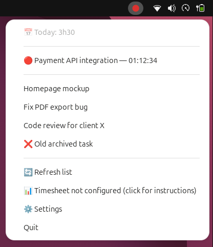

# Wrike Timer

System tray time tracker that talks only to the Wrike API — no third-party service, no data shared with Toggl/Clockify/etc.

The menu lists the 10 tasks you last logged time on; clicking one starts the timer, and clicking the active entry stops it and pushes the time to Wrike. It also shows the total hours logged today (across all tasks, whether logged by the app or directly on the Wrike site), and can offer a direct link to your timesheet.



## Requirements

- Python 3.9+
- **Linux + GNOME**: the system tray needs AppIndicator/StatusNotifierItem support. On **Ubuntu**, the `ubuntu-appindicators` extension is present but **not necessarily enabled** — check with:
  ```bash
  gnome-extensions info ubuntu-appindicators@ubuntu.com   # expects "Enabled: Yes" / "State: ACTIVE"
  ```
  If needed: `gnome-extensions enable ubuntu-appindicators@ubuntu.com`. ⚠️ Under **Wayland**, an extension you just enabled stays `INACTIVE` until the GNOME Shell session is restarted — you need to **log out/back in** (or reboot) for it to take effect; a simple `Alt+F2, r` only works in an X11 session.
  On **other GNOME** distros (Fedora, vanilla Debian, etc.) without this extension preinstalled:
  ```bash
  sudo apt install gnome-shell-extension-appindicator   # or your distro's equivalent
  ```
  then enable it via the "Extensions" app or https://extensions.gnome.org (same reconnect requirement under Wayland).
- KDE, XFCE, Cinnamon, MATE: native support, nothing to install.
- macOS / Windows: `pystray` automatically switches to the right backend — untested by this project (developed/verified on Ubuntu GNOME) but should work as-is.
- **VS Code integrated terminal (snap package)**: if you launch the app from this terminal, `symbol lookup error: ... libpthread.so.0` may show up — the snap injects GTK/GIO env vars that point at its own bundled libraries, incompatible with the system's GTK. `wrike_timer.py` automatically neutralizes these variables at startup (only the ones pointing at `/snap/`, so it has no effect in a regular terminal); if the issue persists, launch the app from a regular system terminal.

## Installation

```bash
git clone <repo-url> wrike-timer
cd wrike-timer
python3 -m venv --system-site-packages .venv
.venv/bin/pip install -r requirements.txt
```

⚠️ **`--system-site-packages` is required on Linux.** Without it, `pystray` can't find the system's GTK/AppIndicator bindings, falls back to a backend that doesn't work under GNOME, and the app starts with no error but **no icon appears** in the tray.

## Setting up the token

1. On Wrike: **Settings → Apps & Integrations → API → generate a Permanent Access Token** (personal use, no OAuth app needed).
2. Then:
   ```bash
   .venv/bin/python wrike_timer.py --set-token
   ```
   The token is entered with masked input and stored in the system keyring (gnome-keyring or equivalent). If no keyring backend is available on the machine, it's stored as a fallback in `~/.config/wrike-timer/config.json` (created with `600` permissions).

   ⚠️ This command needs a real interactive terminal. If you run it from a non-interactive context (script, passthrough), masked input fails with `EOFError` — use `--set-token --token <value>` instead (the token then appears in plain text in shell history, so only for one-off scripting).

**Never share or commit your token.** Everyone using this repo generates their own.

## Running the app

```bash
.venv/bin/python wrike_timer.py
```

The icon appears in the tray. The menu lists the 10 most recently logged tasks; clicking one starts the timer, and the "🔴 ..." entry at the top of the menu stops it and automatically pushes the time to Wrike.

If the submission fails (network down, API unavailable), tracked time is **never lost**: it stays in a local retry queue (visible in the menu as "⚠ N pending submission(s)") and is automatically retried on the next refresh, or manually by clicking the entry.

## Configuration (`~/.config/wrike-timer/config.json`)

| Key | Default | Description |
|---|---|---|
| `refresh_interval_seconds` | `30` | Refresh frequency (task list, today's total, retry of pending submissions) |
| `recent_tasks_limit` | `10` | Number of tasks shown in the menu |
| `recent_tasks_lookback_days` | `30` | Window (in days) to look back for recent tasks |
| `timesheet_url` | `""` | URL of your Wrike timesheet (copied from the browser's address bar, on your Timesheets page). If non-empty, the menu shows "📊 Open my timesheet" (opens the URL in the default browser). If empty, the menu shows "📊 Timesheet not configured (click for instructions)", which reminds you where to add this key. |
| `language` | `"en"` | Language of the tray menu and notifications: `"en"` or `"fr"`. Falls back to `"en"` for any other value. Doesn't affect the CLI (`--set-token`, `--help`, etc.), which is English-only. |

⚠️ Don't confuse this with `~/.local/share/wrike-timer/state.json`: this second file is an **internal cache** (recent tasks, active timer, retry queue, heartbeat), entirely rewritten by the app on every refresh cycle. Any key added by hand in there is ignored and eventually disappears on the next refresh — settings go in `config.json`, never in `state.json`.

The "recent tasks" list is built from your latest timelogs (`trackedDate`/`createdDate` within the `recent_tasks_lookback_days` window), not from assignment or due date. A task assigned to you but on which you've never logged time will therefore never show up in the menu on its own. To make it appear, just add a time entry of at least 1 minute to it (directly on wrike.com, for instance) — it will then show up in the list on the next refresh.

The "📅 Today: Xh XX" total at the top of the menu adds up the `hours` of all your timelogs with `trackedDate` = today, whether they were created by this app or directly on wrike.com. It does not count the time of the currently running timer (not logged yet until it's stopped).

## Launching automatically at startup

```bash
.venv/bin/python wrike_timer.py --install-autostart    # enable
.venv/bin/python wrike_timer.py --uninstall-autostart  # disable
```

On Linux, this writes a file to `~/.config/autostart/`. For macOS/Windows, no automation is provided (untested):
- **macOS**: create a LaunchAgent in `~/Library/LaunchAgents/`.
- **Windows**: shortcut in the Startup folder, or a registry key.

## Development

```bash
.venv/bin/pip install -r requirements-dev.txt
.venv/bin/pytest
```

Periodic check for CVEs in dependencies:
```bash
.venv/bin/pip install pip-audit
.venv/bin/pip-audit
```

### Screenshot of the tray with fake data

```bash
.venv/bin/python scripts/fake_tray_screenshot.py
```

Shows the icon with an active timer and a list of fake tasks (no token or real data required) — handy for illustrating the README or other docs after a menu change. `Ctrl+C` or the "Quit" entry in the menu to stop it.

### CI (once pushed to GitHub)

`.github/workflows/ci.yml` runs `pytest` on Python 3.11 and 3.12 on every push/PR, plus a `pip-audit` job (non-blocking — just a signal). The tests don't depend on any GTK/AppIndicator library (the logic touching pystray is kept to a minimum and the rest is tested in pure Python), but merely importing `pystray` still requires a display to connect to on Linux — the runner has no GTK bindings installed, so it falls back to the plain Xorg backend, which opens a real X connection at import time. CI runs tests under `xvfb-run` (a virtual framebuffer X server) to satisfy that, without needing any GTK/AppIndicator package.

`.github/dependabot.yml` automatically opens a PR every week if a dependency (`requirements*.txt` or the GitHub Actions themselves) has a new version — CI runs on it automatically, so an update that breaks something is visible before merging. That's the answer to "how do we remember to update": Dependabot remembers for you, you just review/merge the PRs it opens.

## Known limitations

- **No notion of "favorites".** The Wrike v4 API exposes no field or endpoint for starred tasks ("Starred tasks" is a purely UI-side smart folder in Wrike, invisible from the API) — impossible to read them from this app. The list is limited to recent tasks.
- The tooltip (icon hover) showing the live timer is best-effort: its rendering depends on the StatusNotifierItem implementation of the theme/DE in use.
- The "start/stop in one click" happens from the dropdown menu, not by clicking the icon directly: the AppIndicator protocol (GNOME/KDE) has no notion of a left-click "default action" distinct from opening the menu, unlike Windows.

## Security

- `.gitignore` excludes `config.json`, `state.json`, and logs from the very first commit — don't force them in with `git add -f`.
- See [AGENTS.md](AGENTS.md) for the full rules on sensitive data that should never be shared.

### Verification git hook

A `pre-commit` hook (`.githooks/pre-commit`) checks that `config.example.json` never contains real data (a real timesheet URL, token, etc.) instead of plain placeholders.

⚠️ Git doesn't enable it automatically on clone — do this once after `git clone`:
```bash
git config core.hooksPath .githooks
```

This is a **local-only** check: CI (see above) does not run this scan.
